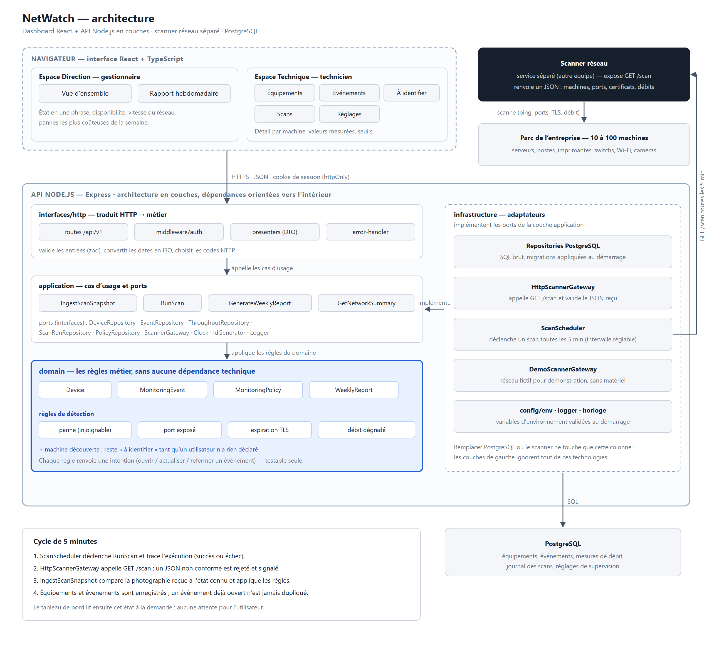

# NetWatch

Supervision réseau pour TPE et PME (10 à 100 machines), pensée pour être installée rapidement chez un client.

Le **scanner** (développé séparément) observe le réseau. L'**API Node.js** l'interroge toutes les 5 minutes,
applique les règles métier et conserve l'historique. Le **dashboard React** présente le résultat à deux publics :
un gestionnaire qui veut savoir si tout va bien, un technicien qui doit diagnostiquer.



## Ce que le produit détecte

| Constat | Famille | Comportement |
| --- | --- | --- |
| Un équipement ne répond plus | **Panne** (incident) | Ouverte après le nombre de scans manqués configuré, refermée automatiquement au retour |
| Débit entre deux machines nettement dégradé | **Observation** | Comparaison à la médiane des 7 derniers jours pour le même trajet |
| Port sensible ouvert | **Signalement** | Liste des ports surveillés configurable |
| Certificat TLS proche de l'expiration | **Signalement** | Préavis de 30 jours par défaut, critique à moins de 7 jours |
| Nouvelle machine sur le réseau | **À configurer** | Reste « à identifier » tant qu'un utilisateur n'a pas déclaré ce qu'elle est |

Un événement déjà ouvert n'est jamais dupliqué : une contrainte en base garantit un seul événement
ouvert par (équipement, cause).

## Démarrage rapide

### Avec Docker (cible d'installation chez le client)

```bash
cp .env.example .env     # renseigner APP_PASSWORD, SESSION_SECRET, POSTGRES_PASSWORD
docker compose up --build
```

Le tableau de bord est sur http://localhost:3001. Avec `SCANNER_MODE=demo` (valeur par défaut),
un réseau fictif est généré : le produit se démontre sans scanner ni matériel.

### En développement

```bash
npm install
cp apps/api/.env.example apps/api/.env   # renseigner DATABASE_URL, APP_PASSWORD, SESSION_SECRET
docker compose stop app                  # libère le port 3001 si la stack Docker tourne
docker compose -f docker-compose.yml -f docker-compose.dev.yml up -d --no-deps db   # PostgreSQL sur localhost:5433
npm run dev                              # API sur :3001, interface sur :5173
```

L'API lit `apps/api/.env`. Pour tester avec le faux scanner (`SCANNER_MODE=http`, `SCANNER_URL=http://localhost:8090`),
voir [tools/scanner-test/README.md](tools/scanner-test/README.md).

| Commande | Rôle |
| --- | --- |
| `npm run dev` | API et interface en parallèle, avec rechargement |
| `npm run build` | Compile contrats, API et interface |
| `npm test` | Tests (règles métier, ingestion, API HTTP) |
| `npm run typecheck` | Vérification des types sur tout le dépôt |
| `npm run migrate` | Applique les migrations SQL (l'API le fait aussi au démarrage) |

## Organisation du dépôt

```
apps/
├── api/                    # API Node.js (Express, TypeScript), architecture en couches
│   ├── migrations/         # SQL appliqué au démarrage, dans l'ordre des noms de fichiers
│   ├── src/
│   │   ├── domain/         # entités, règles de détection, rapport — aucune dépendance technique
│   │   ├── application/    # cas d'usage + ports (interfaces des dépendances)
│   │   ├── infrastructure/ # PostgreSQL, passerelle scanner, planificateur, configuration
│   │   ├── interfaces/http # routes, authentification, présentation (DTO)
│   │   ├── container.ts    # racine de composition : où le concret rencontre l'abstrait
│   │   └── main.ts
│   └── tests/              # tests du domaine, de l'ingestion et de l'API HTTP
└── web/                    # Dashboard React + Vite
    └── src/
        ├── api/            # appels HTTP typés
        ├── auth/           # session et écran de connexion
        ├── components/     # tableaux, badges, graphique de débit
        └── pages/          # espace Direction et espace Technique
packages/
└── contracts/              # types partagés API ↔ interface (le contrat HTTP)
docs/
├── architecture.svg/png    # schéma ci-dessus
└── scanner-contract.md     # ce que l'API attend du scanner
```

### Pourquoi ce découpage

Les dépendances pointent toujours vers l'intérieur : `interfaces/http` → `application` → `domain`,
et `infrastructure` implémente les ports déclarés par `application`. Conséquences concrètes :

- Les règles métier se testent sans base de données ni scanner (voir `tests/domain`).
- Changer PostgreSQL pour autre chose, ou le protocole du scanner, ne touche que `infrastructure/`.
- Le contrat HTTP est figé dans `packages/contracts` : une rupture est détectée à la compilation,
  côté API comme côté interface.

## Configuration

Variables de l'API ([apps/api/.env.example](apps/api/.env.example)), validées au démarrage —
une valeur manquante ou invalide arrête le service avec un message explicite.

| Variable | Défaut | Rôle |
| --- | --- | --- |
| `DATABASE_URL` | — | Connexion PostgreSQL (obligatoire) |
| `PORT` | `3001` | Port d'écoute |
| `SCANNER_MODE` | `demo` | `http` pour interroger le vrai scanner |
| `SCANNER_URL` | — | Obligatoire si `SCANNER_MODE=http` |
| `SCANNER_TOKEN` | — | Envoyé en `Authorization: Bearer` au scanner |
| `APP_PASSWORD` | — | Mot de passe d'accès au tableau de bord (obligatoire, 8 caractères minimum) |
| `SESSION_SECRET` | — | Clé de signature des sessions (obligatoire, 32 caractères minimum) |
| `WEB_DIST_PATH` | — | Dossier de l'interface compilée, servie par l'API en production |

Les **seuils métier** (intervalle de scan, préavis TLS, ports surveillés, seuils de débit, rétention)
ne sont pas dans le `.env` : ils sont en base et se modifient depuis la page « Réglages », sans redéploiement.
C'est ce qui permet d'adapter le produit à chaque client.

## Authentification — état actuel

L'accès est protégé par **un mot de passe partagé** défini dans `APP_PASSWORD`. Une session valide
reçoit un cookie `httpOnly` signé (JWT) et le rôle `admin`. Les rôles `manager`, `technician` et `admin`
existent déjà dans le contrat et `requireRole` est en place, mais **ne restreint encore rien**.

Avant toute commercialisation, il faut : des comptes nominatifs, des mots de passe hachés en base
(argon2 ou bcrypt), `requireRole` appliqué aux routes sensibles, HTTPS obligatoire et une politique
de rotation de `SESSION_SECRET`. C'est volontairement un verrou provisoire, pas un système d'authentification.

## Brancher le vrai scanner

1. Documenter le scanner d'après [docs/scanner-contract.md](docs/scanner-contract.md) — la référence
   exécutable est le schéma de validation `apps/api/src/infrastructure/scanner/snapshot-schema.ts`.
2. Passer `SCANNER_MODE=http` et renseigner `SCANNER_URL` (et `SCANNER_TOKEN` le cas échéant).
3. Vérifier dans la page « Scans » que les exécutions passent en « Réussi » : un JSON non conforme
   y apparaît avec le détail de l'écart.

Si le format du scanner diffère du contrat, la conversion se fait dans `HttpScannerGateway` :
aucune autre partie du code ne connaît son protocole.

## Ce qui reste à faire

- Alertes sortantes : e-mail ou Teams sur ouverture d'incident, et envoi automatique du rapport hebdomadaire
- Comptes utilisateurs et rôles réellement appliqués (voir plus haut)
- Export PDF du rapport hebdomadaire pour la réunion de direction
- Historique de disponibilité par machine sur plusieurs mois, avec graphiques
- Sauvegarde et restauration de la base documentées pour l'installateur
- Tests de bout en bout de l'interface (Playwright)
