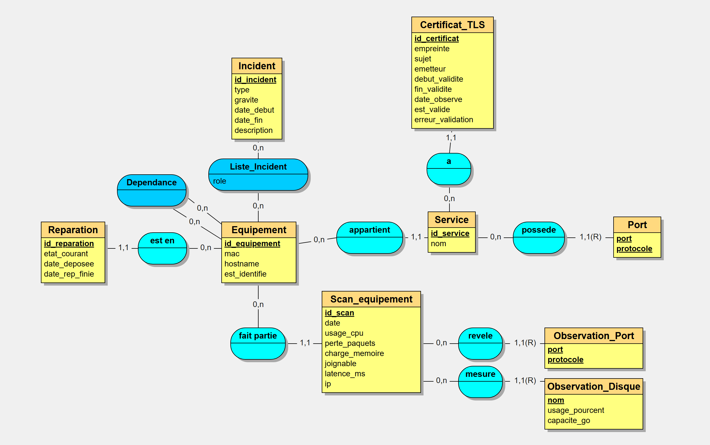

# Modèle de données

Le MCD de référence du projet, et sa correspondance avec les tables PostgreSQL créées par la migration
[006_mcd_reparations_services_scans.sql](../apps/api/migrations/006_mcd_reparations_services_scans.sql).
La migration s'applique toute seule au démarrage de l'API.

**Garder le MCD et la base alignés :** toute évolution du schéma passe, dans le même commit, par une nouvelle
migration (`007_….sql`, jamais la modification d'une migration déjà poussée), la mise à jour de ce document et celle
du MCD ([mcd.png](mcd.png) et sa version modifiable [mcd.svg](mcd.svg)).

**État actuel : les tables du MCD existent mais restent vides.** L'application continue de lire et d'écrire ses
tables d'origine (voir [Tables d'origine](#tables-dorigine)), aucun code n'utilise encore celles-ci.

## Correspondance

| MCD | Table | Colonnes (nom du MCD → colonne) |
| --- | --- | --- |
| Equipement | `devices` (existante) | id_equipement → `id`, mac → `mac`, hostname → `hostname`, est_identifie → `is_identified` |
| Reparation | `repairs` | id_reparation → `id`, etat_courant → `status`, date_deposee → `dropped_off_at`, date_rep_finie → `finished_at` |
| Service | `services` | id_service → `id`, nom → `name` |
| Port | `service_ports` | port → `port`, protocole → `protocol` |
| Certificat_TLS | `tls_certificates` | id_certificat → `id`, empreinte → `fingerprint`, sujet → `subject`, emetteur → `issuer`, debut_validite → `valid_from`, fin_validite → `valid_until`, date_observe → `observed_at`, est_valide → `is_valid`, erreur_validation → `validation_error` |
| Incident | `incidents` | id_incident → `id`, type → `type`, gravite → `severity`, date_debut → `started_at`, date_fin → `ended_at`, description → `description` |
| Scan_equipement | `device_scans` | id_scan → `id`, date → `scanned_at`, usage_cpu → `cpu_percent`, perte_paquets → `packet_loss_percent`, charge_memoire → `memory_percent`, joignable → `reachable`, latence_ms → `latency_ms`, ip → `ip` |
| Observation_Port | `device_scan_ports` | port → `port`, protocole → `protocol` |
| Observation_Disque | `device_scan_disks` | nom → `name`, usage_pourcent → `used_percent`, capacite_go → `capacity_gb` |

| Association | Cardinalités | Traduction |
| --- | --- | --- |
| est en | Equipement 0,n — Reparation 1,1 | `repairs.device_id` (obligatoire) |
| appartient | Equipement 0,n — Service 1,1 | `services.device_id` (obligatoire) |
| possede (R) | Service 0,n — Port 1,1 | clé primaire `service_ports (service_id, port, protocol)` |
| a | Service 0,n — Certificat_TLS 1,1 | `tls_certificates.service_id` (obligatoire) |
| Liste_Incident | Incident 0,n — Equipement 0,n | table `device_incidents (incident_id, device_id, role)` |
| fait partie | Equipement 0,n — Scan_equipement 1,1 | `device_scans.device_id` (obligatoire) |
| revele (R) | Scan_equipement 0,n — Observation_Port 1,1 | clé primaire `device_scan_ports (scan_id, port, protocol)` |
| mesure (R) | Scan_equipement 0,n — Observation_Disque 1,1 | clé primaire `device_scan_disks (scan_id, name)` |
| Dependance | Equipement 0,n — Equipement 0,n | `device_dependencies` (existante, migration 005) |

Détails :

- `devices.is_identified` est **calculée** depuis `lifecycle` et ne s'écrit pas : elle est fausse tant que la
  machine est `pending_classification`.
- `repairs.status` accepte `planned`, `in_progress`, `finished` et `cancelled`. Pour changer ces valeurs, modifier
  la contrainte dans une nouvelle migration.
- `repairs.dropped_off_at` peut être dans le futur : c'est ce qui permet de déclarer une réparation à l'avance.
- `tls_certificates.is_valid` est nulle quand le collecteur n'a pas pu vérifier le certificat.
- `device_incidents.role` est un texte libre (par exemple `cause`, `impactee`).
- Un incident n'est pas relié à un service : il concerne des équipements. Les services touchés se retrouvent par
  leur équipement.
- Supprimer un équipement supprime ses réparations, services, ports, certificats et scans, ainsi que ses liens
  vers les incidents. L'incident lui-même reste.

## Brancher la fonctionnalité de réparation

La base suffit à porter la fonctionnalité ; aucune de ces étapes n'est codée :

1. **Lire et écrire les réparations** : un dépôt `repairs` (port dans
   [repositories.ts](../apps/api/src/application/ports/repositories.ts), implémentation PostgreSQL et
   [en mémoire](../apps/api/src/infrastructure/persistence/memory/in-memory-repositories.ts)), des routes `/api/v1`
   et leurs types dans [packages/contracts](../packages/contracts/src).
2. **Charger les réparations ouvertes à chaque scan** : dans
   [ingest-scan-snapshot.ts](../apps/api/src/application/use-cases/ingest-scan-snapshot.ts), à côté des dépendances.
   Il faudra définir ce qui rend une réparation active (par exemple `planned` ou `in_progress`, avec
   `dropped_off_at` passée).
3. **Changer l'alerte** : `diagnose` et `detectReachabilityChange` dans
   [reachability.ts](../apps/api/src/domain/rules/reachability.ts) décident aujourd'hui de la gravité d'une panne.
   C'est là qu'une machine en réparation donnera un avertissement plutôt qu'une panne.
4. **Interface et documentation** : la fiche équipement
   ([DeviceDetailPage.tsx](../apps/web/src/pages/DeviceDetailPage.tsx)), [api-contract.md](api-contract.md) et les
   exemples (`npm run contract:examples -w @netwatch/api`).

## À prévoir pour alimenter les tables

| Point | À faire |
| --- | --- |
| **Empreinte des certificats** | Le collecteur n'envoie pas encore `empreinte` : l'ajouter à [scanner-contract.md](scanner-contract.md). En attendant, la colonne reste nulle |
| **Services et ports** | Le collecteur envoie des services par port, alors que le MCD rattache des ports à un service : définir la règle de regroupement à l'ingestion |
| **Volume des scans** | Environ 29 000 lignes par jour dans `device_scans` pour 100 machines (un scan toutes les 5 min), plus les ports et les disques : ajouter ces tables à la purge (`PurgeExpiredData`) |

## Tables d'origine

Absentes du MCD, elles restent nécessaires tant que le code n'est pas migré :

| Table ou colonnes | Usage | Recouvrement avec le MCD |
| --- | --- | --- |
| `monitoring_events` | Tous les événements affichés (pannes, signalements, observations) | `incidents` + `device_incidents` |
| `devices.ip`, `latency_ms`, `packet_loss_percent`, `cpu_percent`, `memory`, `disks` | Dernier état affiché et corrélation | `device_scans` + `device_scan_disks` |
| `devices.ports` | Ports et services affichés, règle des ports exposés | `services` + `service_ports`, `device_scan_ports` |
| `devices.certificates` | Certificats affichés, règles TLS | `tls_certificates` |
| `devices.vendor`, `kind`, `label`, `critical`, `lifecycle`, `reachability`, `gateway_ip`, dates | Fiche équipement, classement, rapports | aucun |
| `throughput_samples`, `scan_runs`, `monitoring_settings` | Débit, journal des scans, réglages | aucun |

Passer entièrement aux tables du MCD demande de réécrire les dépôts PostgreSQL et l'ingestion. Une fois cela
fait, une migration pourra retirer ce qui fait doublon.
