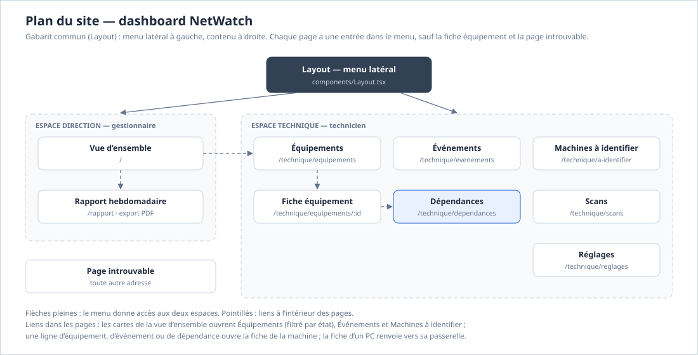
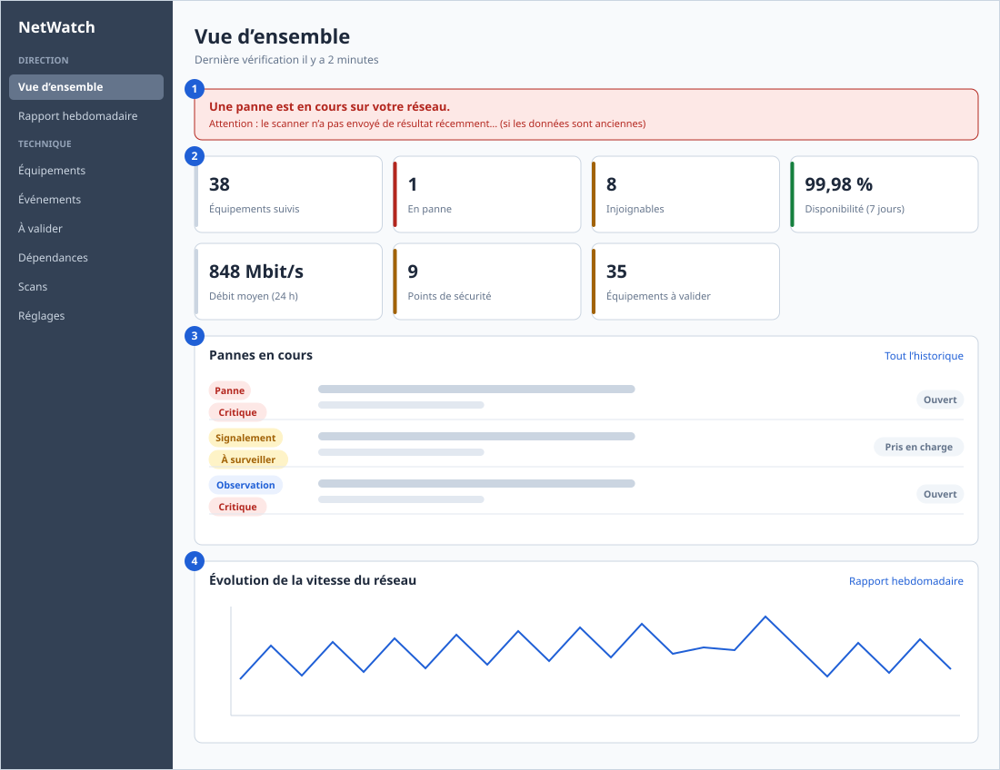
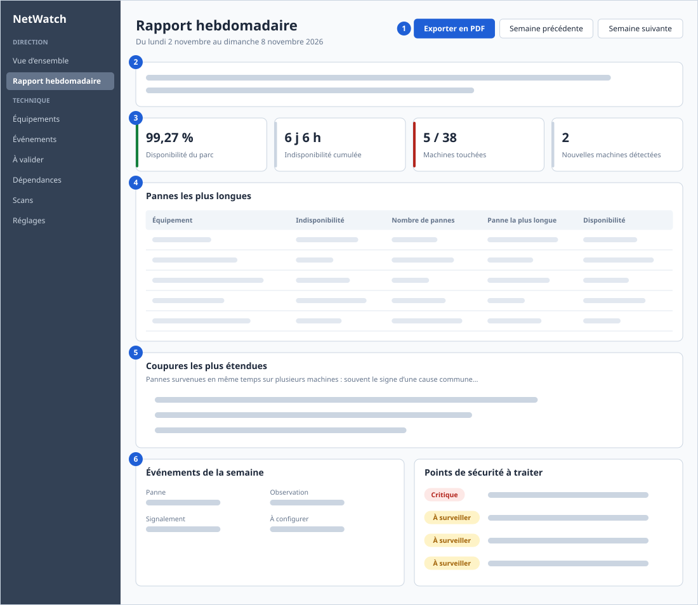
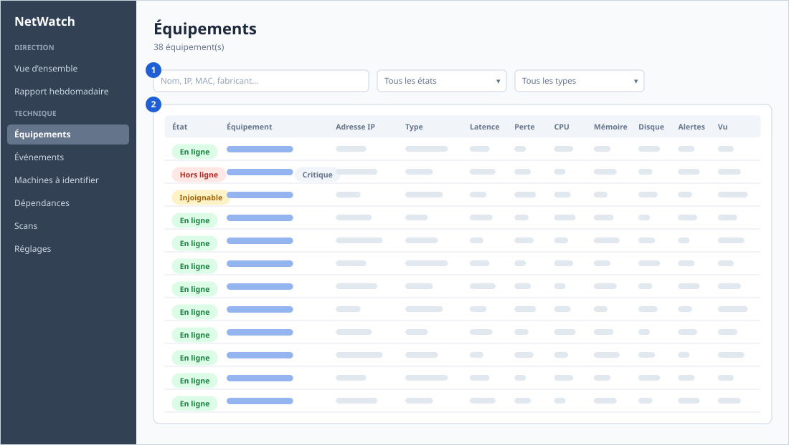
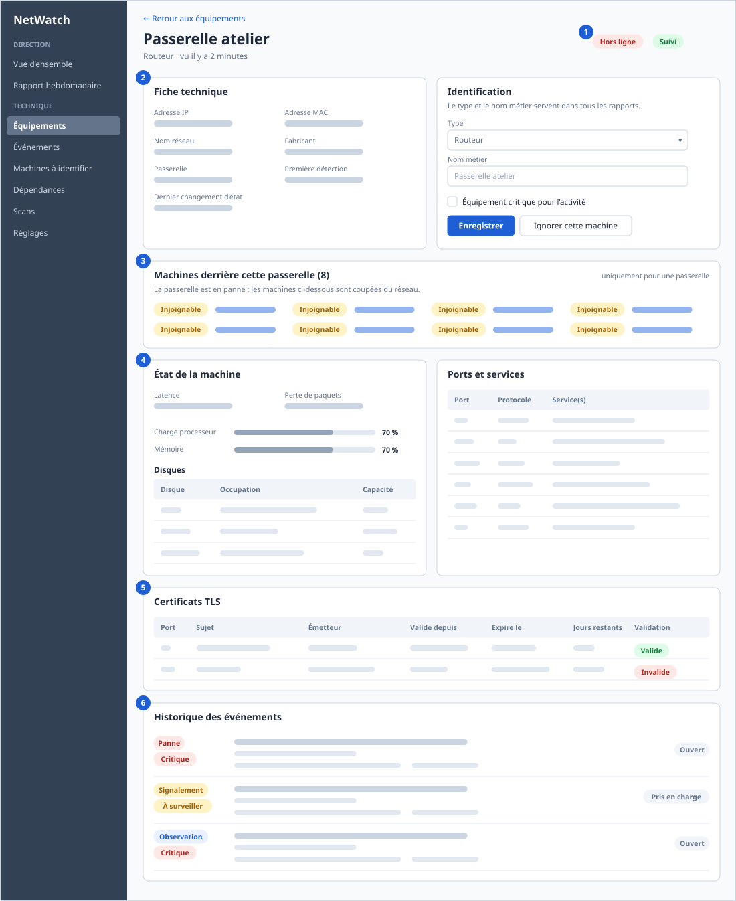
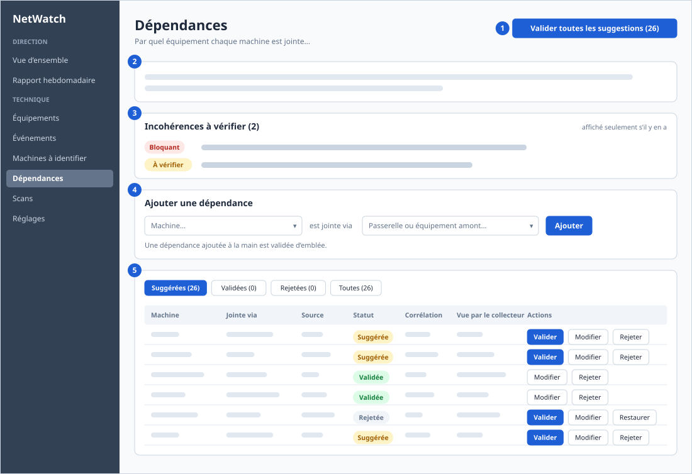
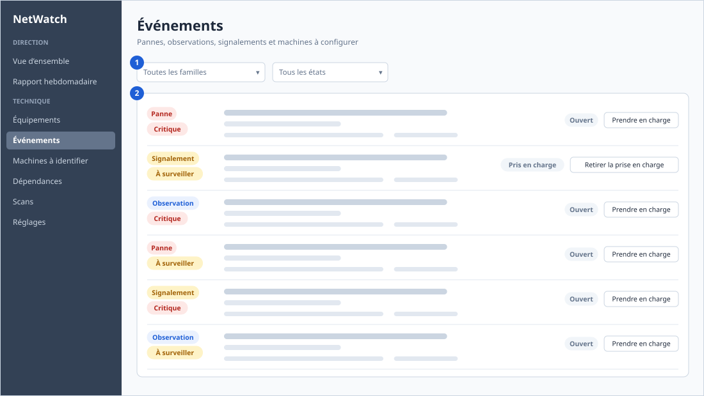
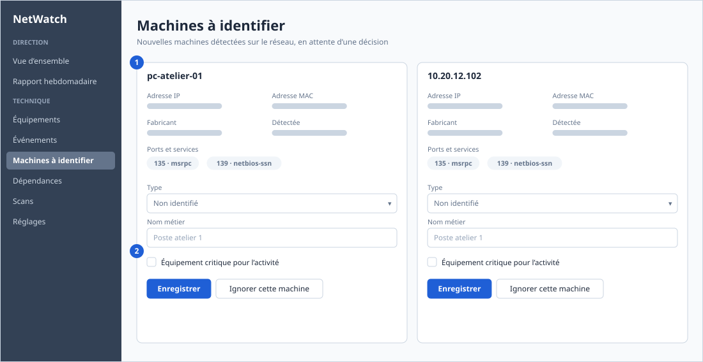
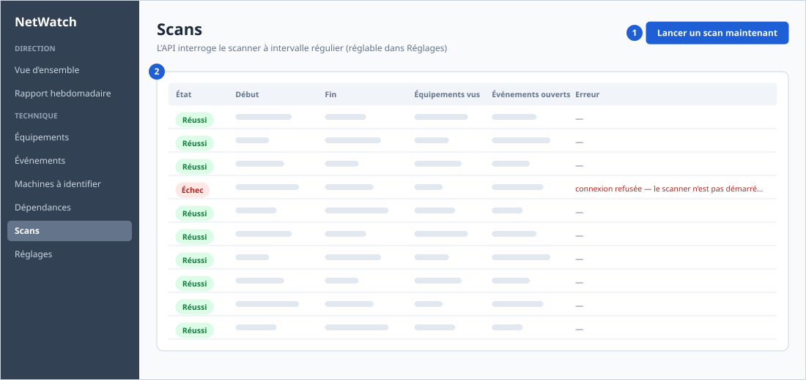
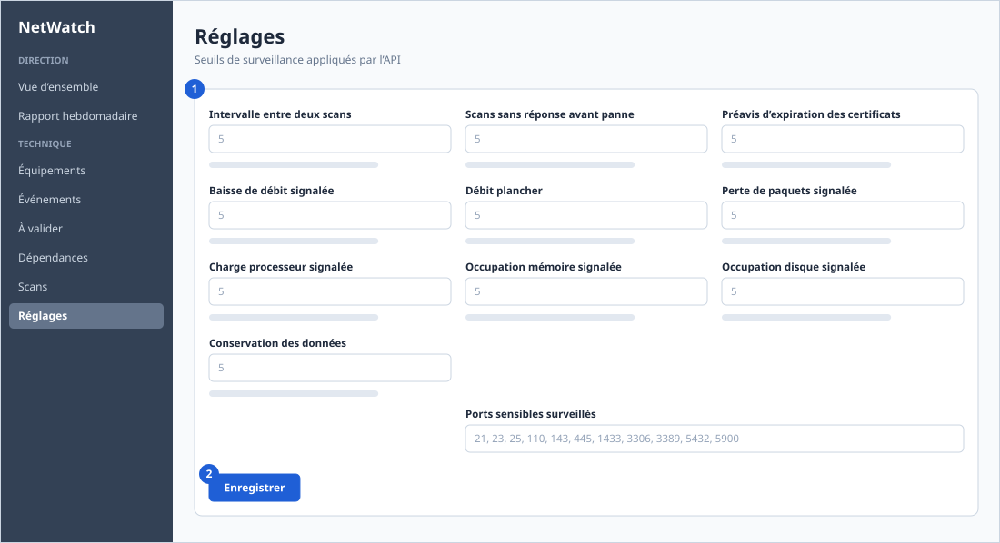

# Squelette de l'application NetWatch

Ce document décrit la structure du dashboard : ses pages, leur disposition, ce que chacune affiche et
d'où viennent les données. Il sert de référence pour développer ou modifier une page sans lire tout le
code.

Pour la vue d'ensemble technique (collecteur, API, base), voir l'[architecture](architecture.png) ; pour
le format des données échangées, voir le [contrat d'échange](api-contract.md).

Les maquettes (dossier [squelette/](squelette)) sont des **fils de fer** : elles montrent la disposition des
zones, pas le rendu final. Les barres grises représentent du texte ou des valeurs. Chaque zone porte un
numéro, détaillé dans le tableau de la page. Après une modification d'écran, régénérez-les avec :

```bash
node tools/squelette/generer-maquettes.mjs
```

## 1. Plan du site



| Adresse | Page | Public | Fichier | Données (API) |
| --- | --- | --- | --- | --- |
| `/` | Vue d'ensemble | gestionnaire | `pages/OverviewPage.tsx` | `GET /summary`, `GET /events?category=incident&status=open`, `GET /metrics/throughput` |
| `/rapport` | Rapport hebdomadaire | gestionnaire | `pages/WeeklyReportPage.tsx` | `GET /reports/weekly?week=`, `GET /reports/weekly.pdf?week=` |
| `/technique/equipements` | Équipements | technicien | `pages/DevicesPage.tsx` | `GET /devices?q=&reachability=&kind=` |
| `/technique/equipements/:id` | Fiche équipement | technicien | `pages/DeviceDetailPage.tsx` | `GET /devices/:id`, `PATCH /devices/:id` |
| `/technique/evenements` | Événements | technicien | `pages/EventsPage.tsx` | `GET /events?category=&status=`, `POST` / `DELETE /events/:id/acknowledge` |
| `/technique/a-identifier` | Machines à identifier | technicien | `pages/PendingDevicesPage.tsx` | `GET /devices?lifecycle=pending_classification`, `PATCH /devices/:id` |
| `/technique/dependances` | Dépendances | technicien | `pages/DependenciesPage.tsx` | `GET`, `POST /dependencies`, `PATCH` / `DELETE /dependencies/:id`, `POST /dependencies/validate-suggestions` |
| `/technique/scans` | Scans | technicien | `pages/ScansPage.tsx` | `GET /scans`, `POST /scans/run` |
| `/technique/reglages` | Réglages | technicien | `pages/SettingsPage.tsx` | `GET` / `PUT /settings` |
| toute autre adresse | Page introuvable | — | `pages/NotFoundPage.tsx` | — |

Les routes d'API sont relatives à `/api/v1`. Les fichiers sont relatifs à `apps/web/src`. Les filtres des
listes (`?reachability=down`, `?category=signalement`…) font partie de l'adresse : on peut partager un lien
vers une liste déjà filtrée.

## 2. Gabarit commun

Toutes les pages sont affichées dans le même gabarit ([components/Layout.tsx](../apps/web/src/components/Layout.tsx)) :

| Élément | Rôle | Composant |
| --- | --- | --- |
| Menu latéral | Deux espaces : **Direction** (gestionnaire : est-ce que tout va bien ?) et **Technique** (technicien : diagnostiquer, corriger). L'entrée de la page affichée est en surbrillance | `Layout` |
| En-tête de page | Titre, sous-titre (contexte, fraîcheur des données), boutons d'action à droite | `PageHeader` |
| Panneaux | Blocs blancs à bordure, avec un titre et parfois un lien à droite | classe CSS `panel` |

Comportements communs à toutes les pages :

- **Actualisation automatique** toutes les 30 secondes (`hooks/usePolling.ts`), suspendue quand l'onglet est
  masqué. Les réglages, le rapport et la liste des machines des formulaires ne se chargent qu'une fois.
- **États** gérés par `components/AsyncState.tsx` : « Chargement… » au premier affichage ; en cas d'erreur, un
  message et un bouton **Réessayer** ; pendant une actualisation, les données déjà affichées restent visibles.
- **Liste vide** : une phrase explicite (« Rien à signaler. », « Aucune machine en attente… »), jamais un
  tableau vide.
- **Couleurs d'état** (vert, orange, rouge) toujours accompagnées d'un texte (« En ligne », « Critique »…).

## 3. Écrans

### 3.1 Vue d'ensemble — `/`

Page d'accueil du gestionnaire : l'état du réseau sans vocabulaire technique.



| N° | Zone | Contenu | Actions |
| --- | --- | --- | --- |
| 1 | Bandeau de santé | Une phrase : « Tout fonctionne normalement », « … des points demandent votre attention » ou « Une panne est en cours ». Avertissement si le collecteur n'a pas répondu récemment | — |
| 2 | Chiffres clés | Équipements suivis, En panne, Injoignables, Disponibilité (7 jours), Débit moyen (24 h), Points de sécurité, Machines à identifier | Chaque carte ouvre la liste correspondante, déjà filtrée |
| 3 | Pannes en cours | Incidents ouverts : famille, gravité, résumé, équipement, durée | « Tout l'historique » → Événements ; clic sur l'équipement → sa fiche |
| 4 | Vitesse du réseau | Courbe des débits mesurés sur 7 jours (actualisée chaque minute) | « Rapport hebdomadaire » |

### 3.2 Rapport hebdomadaire — `/rapport`

Bilan d'une semaine pour la réunion de direction, centré sur les incidents les plus conséquents.



| N° | Zone | Contenu | Actions |
| --- | --- | --- | --- |
| 1 | Actions | — | **Exporter en PDF** (télécharge le rapport de la semaine affichée), Semaine précédente / suivante |
| 2 | Synthèse | Deux ou trois phrases lisibles sans connaissance réseau | — |
| 3 | Chiffres clés | Disponibilité du parc (et semaine précédente), indisponibilité cumulée, machines touchées, nouvelles machines | — |
| 4 | Pannes les plus longues | Tableau par équipement : indisponibilité, nombre de pannes, panne la plus longue, disponibilité ; équipements critiques signalés | — |
| 5 | Coupures les plus étendues | Pannes simultanées sur plusieurs machines (cause commune probable) | — |
| 6 | Événements et sécurité | Nombre d'événements par famille ; points de sécurité encore ouverts, avec leur gravité | — |

### 3.3 Équipements — `/technique/equipements`

Tout le parc, avec les mesures du dernier scan.



| N° | Zone | Contenu | Actions |
| --- | --- | --- | --- |
| 1 | Filtres | Recherche (nom, IP, MAC, fabricant), état (en ligne, hors ligne, injoignable, inconnu), type | Les filtres sont repris dans l'adresse |
| 2 | Tableau | État, équipement (étiquettes « Critique », « À identifier »), IP, type, latence, perte de paquets, CPU, mémoire, disque le plus rempli, nombre d'alertes ouvertes, dernière réponse | Clic sur un nom → fiche équipement |

### 3.4 Fiche équipement — `/technique/equipements/:id`

Tout ce que l'on sait d'une machine, et l'endroit où on l'identifie.



| N° | Zone | Contenu | Actions |
| --- | --- | --- | --- |
| 1 | En-tête | Nom métier (ou nom réseau, ou IP), type, dernière réponse ; état (En ligne, Hors ligne, Injoignable) et cycle de vie (À identifier, Suivi, Ignoré) | « ← Retour aux équipements » |
| 2 | Fiche technique et identification | IP, MAC, nom réseau, fabricant, **passerelle** (selon les dépendances validées), première détection, dernier changement d'état ; formulaire type, nom métier, critique | **Enregistrer**, **Ignorer cette machine** ; clic sur la passerelle → sa fiche |
| 3 | Machines derrière cette passerelle | *Seulement pour une passerelle* : machines qui en dépendent et leur état ; phrase indiquant s'il s'agit d'une panne de la passerelle ou d'une panne en aval | Clic → fiche de la machine |
| 4 | État et ports | Latence, perte de paquets, jauges CPU et mémoire, disques ; ports ouverts avec protocole et services détectés | — |
| 5 | Certificats TLS | Port, sujet, émetteur, dates de validité, jours restants, résultat de la vérification et raison d'un refus | — |
| 6 | Historique | Événements de la machine (100 derniers), avec leurs valeurs mesurées | — |

### 3.5 Dépendances — `/technique/dependances`

Le graphe « par quel équipement chaque machine est jointe », sous contrôle humain. Seules les dépendances
**validées** servent à distinguer une passerelle en panne de machines en panne.



| N° | Zone | Contenu | Actions |
| --- | --- | --- | --- |
| 1 | Validation en masse | Nombre de suggestions en attente | **Valider toutes les suggestions** (sauf celles qui créeraient un cycle ou contredisent une dépendance validée) |
| 2 | Explication | Ce qu'est une suggestion, ce que change la validation | — |
| 3 | Incohérences | *Seulement s'il y en a* : cycles (bloquant), passerelle différente de celle validée, dépendance vers un équipement ignoré, plusieurs dépendances validées | — |
| 4 | Ajout manuel | « Machine… est jointe via… » | **Ajouter** (validée d'emblée ; un cycle est refusé avec un message) |
| 5 | Liste | Onglets Suggérées / Validées / Rejetées / Toutes ; machine, passerelle, source (collecteur ou manuelle), statut, utilisée ou non par la corrélation, dernière observation par le collecteur ; lignes en incohérence surlignées | **Valider**, **Modifier** (choisir un autre équipement), **Rejeter** / **Supprimer**, **Restaurer** une suggestion rejetée |

### 3.6 Événements — `/technique/evenements`

Historique complet de ce que l'API a détecté.



| N° | Zone | Contenu | Actions |
| --- | --- | --- | --- |
| 1 | Filtres | Famille (panne, observation, signalement, à configurer), état (ouvert, pris en charge, résolu) | Les filtres sont repris dans l'adresse |
| 2 | Liste | Famille, gravité, résumé, équipement, durée, valeurs mesurées, état | **Prendre en charge**, **Retirer la prise en charge** ; clic sur l'équipement → sa fiche |

### 3.7 Machines à identifier — `/technique/a-identifier`

File d'attente des machines détectées dont on ne sait pas encore ce qu'elles sont.



| N° | Zone | Contenu | Actions |
| --- | --- | --- | --- |
| 1 | Carte par machine | IP, MAC, fabricant, date de détection, ports et services | — |
| 2 | Identification | Type, nom métier, critique | **Enregistrer** (la machine passe « Suivi » et sort de la liste), **Ignorer cette machine** |

### 3.8 Scans — `/technique/scans`

Journal des interrogations du collecteur : la première page à ouvrir si les données semblent figées.



| N° | Zone | Contenu | Actions |
| --- | --- | --- | --- |
| 1 | Scan immédiat | — | **Lancer un scan maintenant** |
| 2 | Journal | 20 derniers scans : état (réussi, échec, en cours), début, fin, équipements vus, événements ouverts, raison d'un échec (« connexion refusée », JSON non conforme…) | — |

### 3.9 Réglages — `/technique/reglages`

Les seuils appliqués par l'API, modifiables sans redéploiement.



| N° | Zone | Contenu | Actions |
| --- | --- | --- | --- |
| 1 | Seuils | Intervalle entre deux scans, scans manqués avant panne, préavis TLS, baisse et plancher de débit, perte de paquets, CPU, mémoire, disque, durée de conservation, ports sensibles surveillés | — |
| 2 | Enregistrement | — | **Enregistrer** (une valeur hors limites est refusée avec le détail de l'erreur) |

### 3.10 Page introuvable

Titre « Page introuvable » et lien de retour vers la vue d'ensemble, pour toute adresse inconnue.

## 4. Squelette du code du dashboard

```
apps/web/src/
├── main.tsx                 point d'entrée : monte <App /> dans index.html
├── App.tsx                  routeur : une route par page (section 1)
├── config.ts                adresse de l'API, rythme d'actualisation
├── api/
│   ├── client.ts            appel HTTP générique : délai maximal, erreurs { error: { code, message } }
│   └── netwatch.ts          une fonction par route de l'API, typée avec packages/contracts
├── hooks/
│   └── usePolling.ts        chargement + actualisation périodique
├── components/              briques réutilisées par plusieurs pages
│   ├── Layout.tsx           gabarit : menu latéral + contenu
│   ├── PageHeader.tsx       titre, sous-titre, actions
│   ├── AsyncState.tsx       chargement / erreur / réessayer
│   ├── StatCard.tsx         carte de chiffre clé (vue d'ensemble, rapport)
│   ├── DeviceTable.tsx      tableau des équipements
│   ├── EventList.tsx        liste d'événements (vue d'ensemble, événements, fiche)
│   ├── ClassifyDeviceForm.tsx  formulaire d'identification (fiche, machines à identifier)
│   ├── Metrics.tsx          jauges, valeurs colorées, ports, badge de certificat
│   ├── Badges.tsx           badges d'état, de gravité, de famille
│   └── ThroughputChart.tsx  courbe de débit
├── pages/                   une page = un fichier (section 3)
├── utils/format.ts          libellés français, dates, durées, pourcentages, teintes
└── styles/global.css        styles (couleurs, panneaux, tableaux, badges)
```

Le chemin d'une donnée, de l'API à l'écran :

```
page (pages/*.tsx)
  └─ usePolling(() => api.getDevices(filtres))      hooks/usePolling.ts
       └─ api.getDevices                            api/netwatch.ts  (types : packages/contracts)
            └─ request('/devices?…')                api/client.ts
                 └─ GET /api/v1/devices             API Node (docs/api-contract.md)
```

### Ajouter une page

1. Créer `pages/MaPage.tsx` en reprenant `PageHeader`, `AsyncState` et `usePolling`.
2. Déclarer la route dans `App.tsx` et, si elle doit apparaître dans le menu, son entrée dans `components/Layout.tsx`.
3. Si elle appelle une nouvelle route d'API : l'ajouter dans `api/netwatch.ts`, avec ses types dans
   `packages/contracts` et sa description dans [api-contract.md](api-contract.md).
4. Ajouter sa maquette dans `tools/squelette/generer-maquettes.mjs`, la régénérer, puis la décrire ici.
